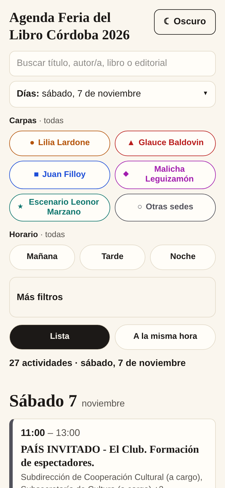
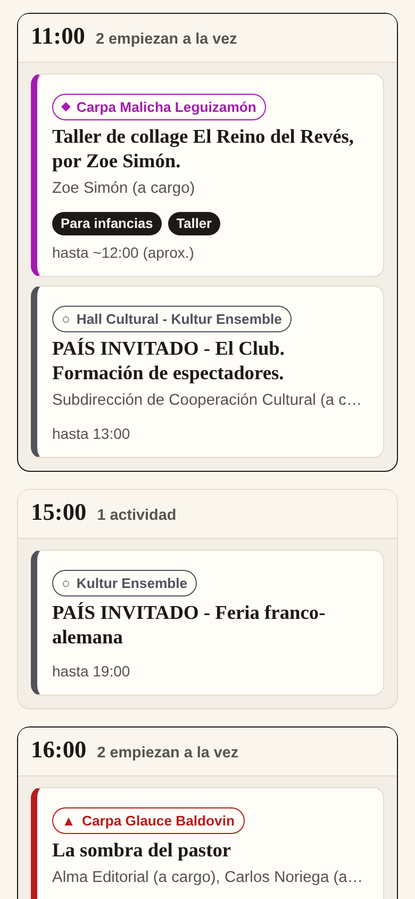

# Agenda Feria del Libro Córdoba 2026

Agenda visual, filtrable y buscable de la programación de la Feria del Libro Córdoba 2026 (30/10 al 15/11), pensada para usarla desde el celular en el predio.

> **Proyecto no oficial.** No tiene vínculo con la organización de la feria ni con la Municipalidad de Córdoba. La programación oficial está en [feriadellibro.cordoba.gob.ar/programacion](https://feriadellibro.cordoba.gob.ar/programacion/) y puede cambiar.

**Web:** https://illak.github.io/agenda-feria-libro-cordoba-2026/

<p>
  
  
</p>

## Qué hace

- Lista por día, con un calendario para elegir un día o un rango.
- Filtros por carpa, horario, ciclo, tema, tipo de actividad y público. Todo queda en la URL, así que una vista filtrada se comparte con un enlace.
- Búsqueda tolerante a errores de tipeo y a los acentos, con sugerencias mientras se escribe.
- Vista **A la misma hora**: las actividades agrupadas por hora de inicio, para decidir a cuál ir.
- Detalle de cada actividad, con lo que pasa al mismo tiempo.
- Agregar una actividad a **Google Calendar** o descargarla como archivo **.ics** (Apple Calendar, Outlook y otros).
- Enlace directo a cada actividad (`?evento=<id>`), para compartirla.
- Tema claro y oscuro.

El color de la carpa nunca va solo: siempre lo acompañan un símbolo y el nombre.

## Cómo correrlo

Web (Node 22 o más):

```bash
cd web
npm install
npm run dev      # servidor de desarrollo
npm test         # tests con Vitest
npm run build    # sitio estático en web/dist
```

Pipeline de datos (Python 3.12 y [uv](https://docs.astral.sh/uv/)):

```bash
cd pipeline
uv run pytest                  # tests contra fixtures/, nunca contra la URL en vivo
uv run python -m feria.build   # genera data/eventos.json, sedes.json y meta.json
```

## Cómo se actualizan los datos

La programación vive en un Google Doc. Los datos se actualizan **a mano y en local**: se descarga el doc, se extraen con regex y con subagentes de Claude Code los campos que la regex no resuelve (personas con rol, libros, editorial, temas), y se publica en `web/public/data/`. El procedimiento completo está en [`docs/actualizacion.md`](docs/actualizacion.md).

## Estructura

```
pipeline/    descarga, parseo, normalización y publicación de los datos (Python)
fixtures/    copias crudas del Google Doc (no se editan)
data/        JSON generados por el pipeline
web/         la aplicación (Vite, JavaScript vanilla, Tailwind 4)
docs/        requerimientos y procedimiento de actualización
```

Las especificaciones están en [`docs/requerimientos.md`](docs/requerimientos.md).

## Datos y atribución

La programación es de la **Feria del Libro Córdoba (Municipalidad de Córdoba)**, publicada en su Google Doc oficial. Este repositorio guarda copias en `fixtures/` y `data/` para que el proceso se pueda reproducir. Esos contenidos **no están bajo la licencia del código** y no son de quien mantiene este proyecto.

Lo que agrega este proyecto (temas, roles de las personas, libros presentados y normalización de sedes) es un procesamiento automático sobre ese contenido y puede tener errores. Si algo está mal, o si querés que se retire o se corrija un dato, abrí un [issue](https://github.com/illak/agenda-feria-libro-cordoba-2026/issues).

## Licencia y créditos

El código se distribuye bajo la licencia **GPL-3.0-or-later**; ver [`LICENSE`](LICENSE).

Copyright (C) 2026 Illak Zapata.
